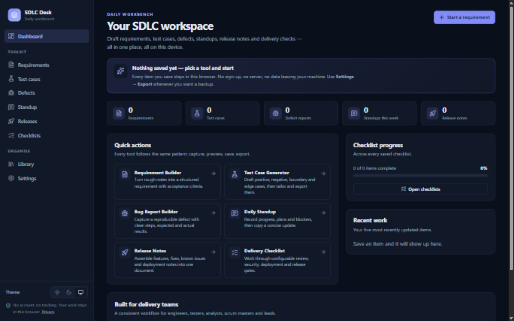

# SDLC Desk

A local-first daily workbench for software delivery teams: write requirements, draft test cases, log defects, prepare standups, assemble release notes and work through delivery checklists — without an account, a backend or a single outbound data call.

Built with React, TypeScript and Vite. Deployed as a static site on GitHub Pages.

**Live app:** https://vijaytanguturi.github.io/sdlc-desk/



---

## Why this exists

Most SDLC work is scattered across tickets, documents, chat threads and spreadsheets. SDLC Desk gives engineers, QA engineers, business analysts, scrum masters, project managers and engineering leads one small, fast place to produce the artefacts they create every week.

It deliberately does **not** try to be a tracker or a system of record. It produces clean, copy-ready output that you paste into the tools your organisation already uses.

## What is included

| Tool | What it does | Export |
| --- | --- | --- |
| **Requirement Builder** | Business objective, functional requirements, assumptions, dependencies and acceptance criteria in one structured document. | Markdown |
| **Test Case Generator** | Builds a review-ready starter set from proven test heuristics (positive, negative, boundary, edge), then lets you edit, add and delete every field. | CSV, Markdown |
| **Bug Report Builder** | Title, environment, severity, priority, reproduction steps, actual and expected result, supporting notes. | Markdown, clipboard |
| **Daily Standup** | Yesterday, today, blockers. Can carry the previous plan forward. Keeps a local history. | Markdown, clipboard |
| **Release Notes Builder** | Features, fixes, enhancements, known issues and deployment notes in one release document. | Markdown |
| **Delivery Checklist** | Configurable code review, testing, security, deployment and release-readiness gates. Ticks auto-save once the checklist is named. | Markdown |
| **Library** | Search every saved item by title or content, filter by tool, reopen or delete. | — |
| **Settings** | Light/dark/system theme, JSON backup and restore, clear data, privacy notice. | JSON |

Additional behaviour:

- Polished responsive layout with a desktop sidebar and a mobile drawer.
- Light and dark themes that follow the system by default.
- Empty states, inline validation, confirmation dialogs and toast feedback.
- Copy-to-clipboard and file downloads generated entirely in the browser.
- Versioned local storage document with defensive parsing: one corrupt item cannot lock you out of the rest.
- Storage-quota and unavailable-storage errors surfaced to the user instead of silently losing work.
- An error boundary so an unexpected render failure does not take the whole page down.

## Privacy model

- **Local only.** Work items, settings and checklist progress live in the browser's `localStorage` under `sdlc-desk.workspace`.
- **No account, no backend.** There is no server component, no database and no cloud sync.
- **No analytics or trackers.** No third-party scripts, no external fonts, no CDN requests. Assets are bundled by Vite and icons come from the locally installed `lucide-react` package.
- **No AI service.** The test-case generator is a deterministic, rule-based template engine. It never calls a model or transmits the requirement text.
- **Backups are manual.** Use Settings → Export backup to move your work between browsers or machines.
- **Shared devices.** Anyone with access to the browser profile can read or export the data. Clear it from Settings when you finish.

> SDLC Desk is a productivity aid, not a certified system. It is not ISO 27001 or SOC 2 certified and is not a system of record. Follow your organisation's data-handling policy: do not store customer data, personal data, credentials, production secrets or confidential material unless your employer permits it on the device.

## Architecture

```
src/
  app/            routing, app shell, theme application
  components/     design-system primitives (buttons, fields, cards, modal, previews)
  features/
    requirements/ requirement builder
    testcases/    test case generator and editor
    bugs/         defect builder
    standup/      daily standup
    release/      release notes
    checklists/   delivery checklists
  hooks/          item loading and per-tool selectors
  lib/            types, storage adapter, store, exporters, generator, search
  pages/          dashboard, library, settings, not-found
  test/           Vitest setup
e2e/              Playwright specs
```

Key boundaries:

- **Storage adapter** (`src/lib/storage.ts`) exposes `getItem`/`setItem`/`removeItem`. Swapping in IndexedDB or a future sync API means implementing that interface, not rewriting tool pages.
- **Generator interface** (`src/lib/generator.ts`) already separates "generate" from the UI. An AI-backed generator can be added later behind the same contract while the rule-based one remains the offline default.
- **Exporters** (`src/lib/exporters.ts`) are pure functions, unit tested independently of React.
- **State** lives in a small Zustand store (`src/lib/store.ts`) that persists through the adapter on every mutation.

Routing uses `HashRouter` so deep links work on GitHub Pages without server rewrite rules. Vite's `base` is `./`, which keeps the build portable across project pages, custom domains and local previews.

## Local development

Requirements: Node.js 22.12+ (built and tested with Node 26) and npm.

```bash
npm install
npm run dev
```

Open the URL Vite prints (default `http://127.0.0.1:5173`).

### Scripts

| Command | Purpose |
| --- | --- |
| `npm run dev` | Start the development server |
| `npm run build` | Type-check and produce the production build in `dist/` |
| `npm run preview` | Serve the production build locally |
| `npm run lint` | Run oxlint |
| `npm run typecheck` | Type-check without emitting |
| `npm test` | Run the Vitest unit and component suite |
| `npm run test:e2e` | Run Playwright end-to-end tests (desktop + mobile) |
| `npm run test:e2e:install` | Install the browsers used by Playwright |

## Testing

- **Unit and component tests** cover markdown/CSV exports, storage parsing and failure handling, the store, search, checklist math, the rule-based generator, and the requirement, checklist and library screens.
- **Playwright** covers every tool end to end on Chromium, Firefox, WebKit and a Pixel 7 viewport: create → preview → save → reload → reopen → export, plus clipboard copy (Chromium), backup/restore, theme persistence, routing and horizontal-overflow checks.

Test results are reported truthfully: run the commands above to reproduce them. CI runs lint, unit tests, build and the Playwright suite on every push and pull request.

## Deployment

The app is a static site. `.github/workflows/deploy.yml` builds it on pushes to `main` and publishes `dist/` through GitHub Pages. `.github/workflows/ci.yml` runs quality gates on pushes and pull requests.

To deploy your own fork:

1. Push to `main`.
2. In **Settings → Pages**, set the source to **GitHub Actions**.
3. The workflow publishes to `https://<user>.github.io/sdlc-desk/`.

No paid hosting, server or external service is required.

## Roadmap

The MVP intentionally stops at local persistence. Planned directions, each behind an existing interface:

- IndexedDB adapter for larger workspaces.
- Optional, explicitly enabled AI assistance for requirement and test-case drafting (never enabled by default).
- Team sync or shared templates behind a user-configured backend.
- Additional exporters (Jira/ADO-friendly formats, printable PDFs).
- Import from existing requirement documents.

## License

[MIT](LICENSE) © 2026 Vijay Tanguturi
